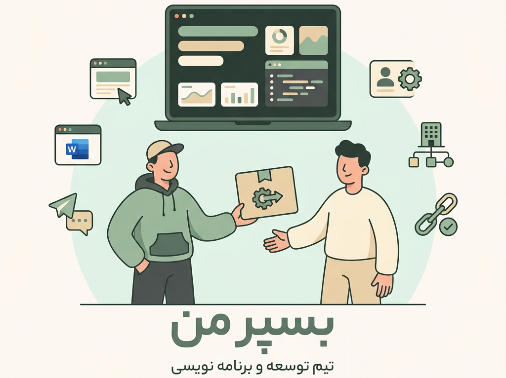

# Besporman

Portfolio and client intake website for Besporman, a freelance software development team based in Iran focusing on website development, Telegram bots, and Windows desktop tools.

<p align="center">
  
</p>

## Overview

The site is built with Vue 3 and TypeScript, designed with an authentic paper-and-ink aesthetic. It presents the team's services, portfolio projects, and direct contact options with full RTL support and custom typography.

## Tech stack

- Vue 3 (Composition API)
- TypeScript
- Vite
- Vue Router 4
- Vanilla CSS with custom design tokens

## Getting started

Install dependencies:

```bash
npm install
```

Start the local development server:

```bash
npm run dev
```

Run tests:

```bash
npm test
```

Build for production:

```bash
npm run build
```

